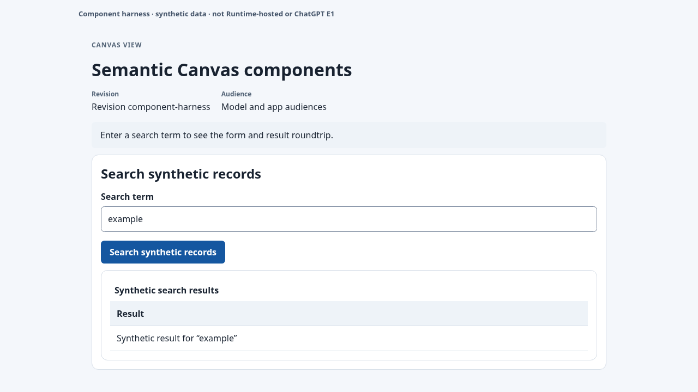

# Semantic Canvas renderer

This directory owns reusable React components for the canonical
`actions.canvas-spec/v1` contract from PR #330 (`96e255c729becf63dec14937b8de33d2fb8e11ad`).
`fixtures/canvas-spec-v1.fixture.json` is a byte-for-byte snapshot of PR #330's
positive fixture so this isolated lane can test the consumer before the source
contract is integrated. PR #330 remains the canonical schema and fixture
owner; this snapshot is not a second schema definition.

The pure `SemanticCanvasRenderer` consumes the validated document plus injected
typed adapters. Logical `bindingId` values resolve only through those adapters;
the document cannot select tools, URLs, files, credentials, or execution
expressions. Workspace, Deployment, authorization, and official MCP Apps
bridge authority remain host responsibilities. The host must provide a
`scopeKey` containing the authorized app and binding scope, immutable revision,
and node identity so a changed scope remounts forms and clears old input and
results.

The renderer composes stack, text, form, table, status, and artifact nodes.
Integer and boolean form fields are converted to JSON number and boolean
values. Tables use their declared `rowsKey` and display cell data as plain
text. Empty visibility hides the title, revision, and content with a generic
notice. Visibility is an audience projection, not authorization. Preview mode
does not dispatch forms, read live status, or open artifacts.

Local structural checks protect the component boundary from malformed
documents, but the central #100 validator remains responsible for canonical
schema validation, cross-field rules, and document limits. `McpCanvasView.tsx`,
`src/canvas-contract/**`, and official bridge wiring are integrator-owned.

## Tests

From `action_server/frontend` run:

```sh
npx vitest --run --config apps/canvas-view/src/semantic-renderer/vitest.config.ts
npx eslint --max-warnings 0 apps/canvas-view/src/semantic-renderer
npx prettier --end-of-line auto --check apps/canvas-view/src/semantic-renderer
npx tsc --noEmit --strict --target ESNext --lib DOM,ESNext --module ESNext --jsx react-jsx --moduleResolution bundler --types vite/client,node,vitest/globals --allowSyntheticDefaultImports --skipLibCheck apps/canvas-view/src/semantic-renderer/*.ts apps/canvas-view/src/semantic-renderer/*.tsx
CANVAS_PLAYWRIGHT_CHROMIUM_EXECUTABLE_PATH=/usr/bin/chromium npx playwright test --config apps/canvas-view/src/semantic-renderer/playwright.config.ts
```

Component and browser harness tests use test adapters with synthetic
dispatch. They do not demonstrate the Runtime-hosted MCP Apps bridge or
authenticated ChatGPT E1. The existing screenshot has the same limited scope.


