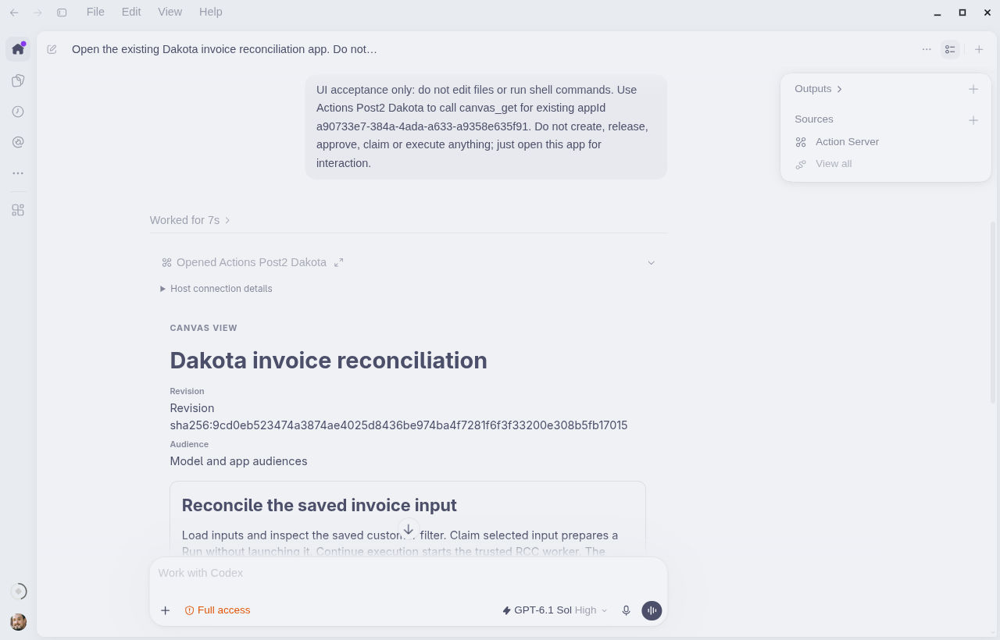
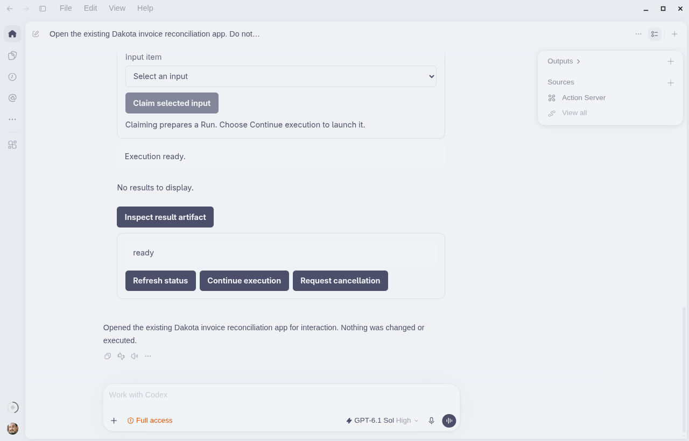
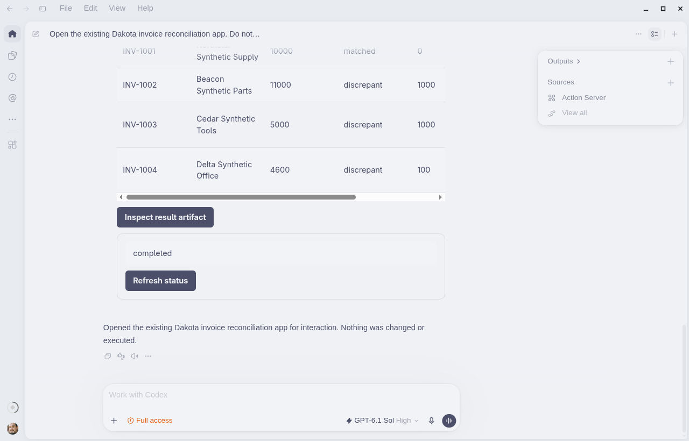
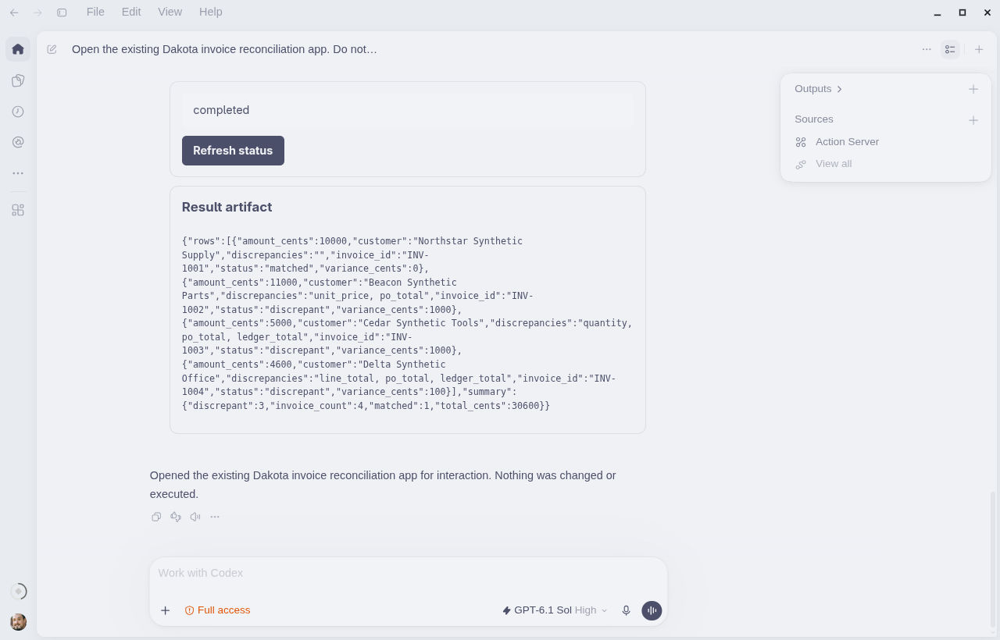
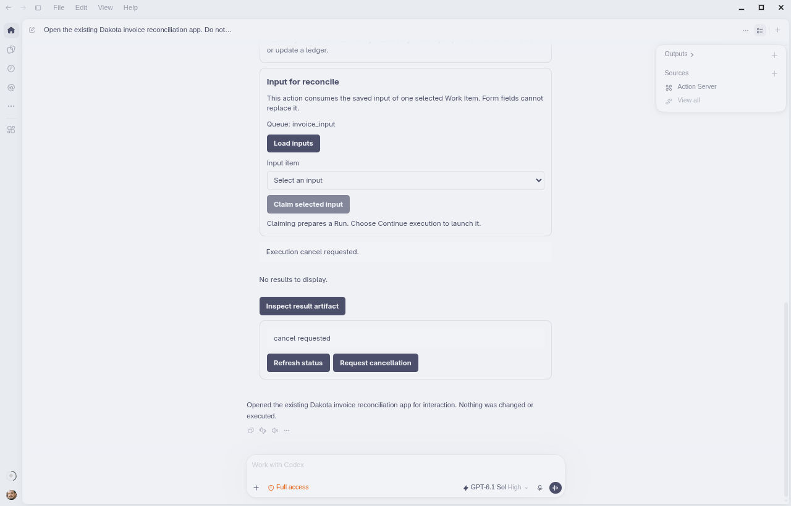

# Real desktop evidence

Tested source `e38b37d614dc5a4e80ba0639f641aa536f5d0710`, Runtime wheel `2b568aa578a8c42acd0402e497fbfebc343d845ae3c390074201b678adf48f41`, RCC18.19.8, ChatGPT desktop26.1029.61003. **These successful captures are Codex mode, not ChatGPT-mode E1.**

The original user-created app was opened; actual desktop controls loaded and selected saved input, claimed it, launched RCC, rendered bound rows and inspected the persisted artifact. Source, process lineage, limitations and image hashes are in [receipt.json](receipt.json).

2026-11-06T00:06:24.659693+00:00 — Existing v2 app opens in the actual desktop; no new app created.

2026-11-06T00:08:53.869118+00:00 — Claim created a Run with no launch; Continue execution remained explicit.

2026-11-06T00:09:38.017330+00:00 — Real RCC completion rendered the four invoice rows. This capture is a scrolled viewport.

2026-11-06T00:11:00.991096+00:00 — Authorized artifact inspection displayed the persisted report and 30600-cent total.

2026-11-06T00:18:25.161819+00:00 — Cancellation intent is visible; this is not terminal cancellation or stopped-process proof.

