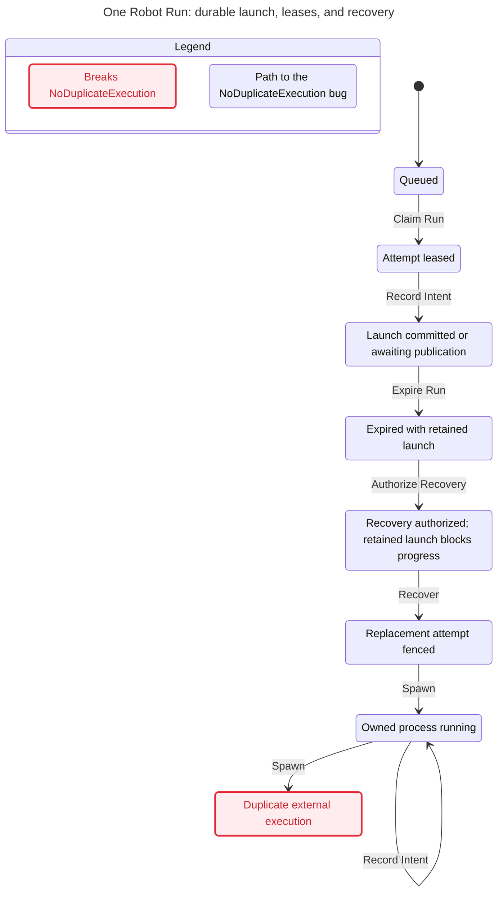
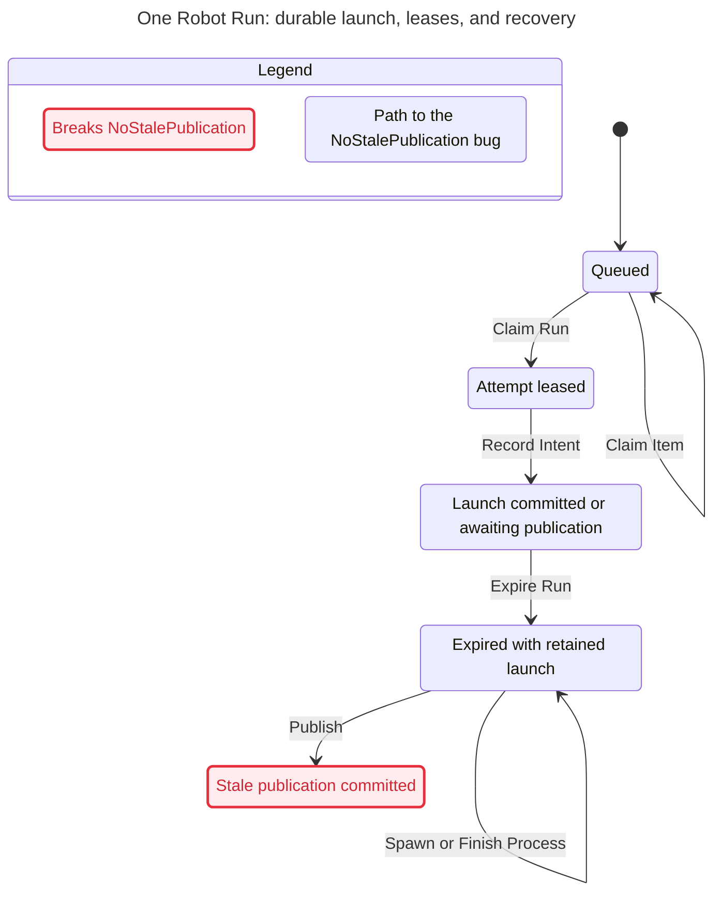
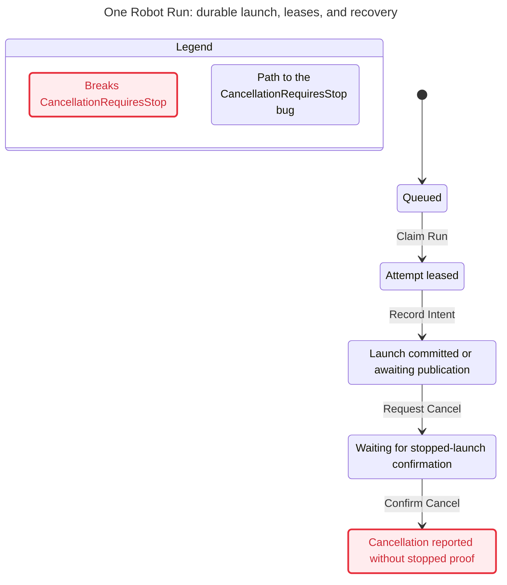
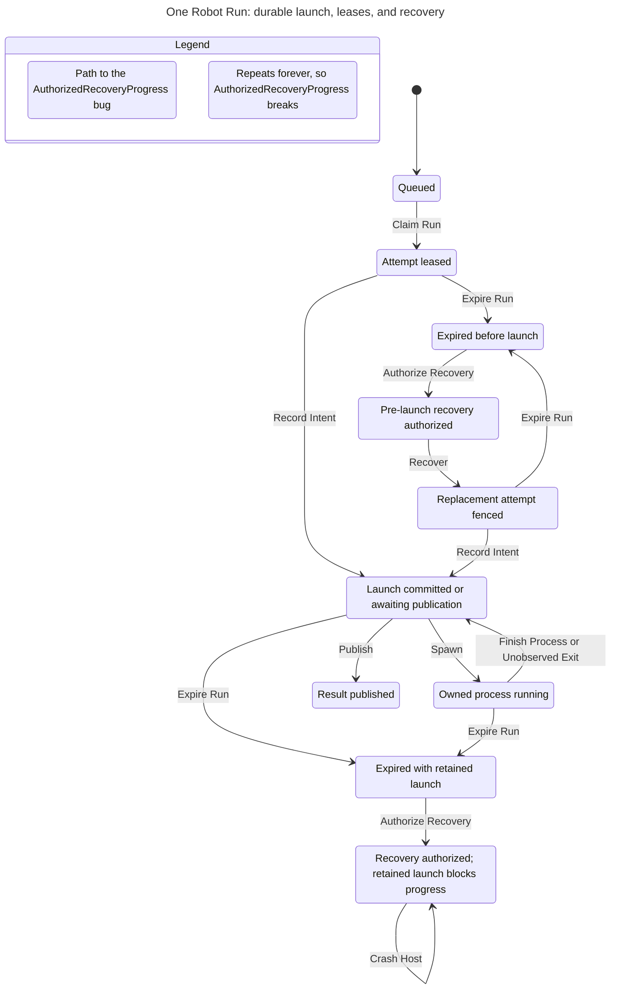

# Bounded lifecycle counterexamples

These are deliberate guard mutations, not failures of the repaired Runtime.

## broken-recovery

## broken-publication

## broken-cancel

## Retained-launch progression remains unsupported

This is a current missing progression, not a deliberate mutation. Safe refusal does not settle the Run.

